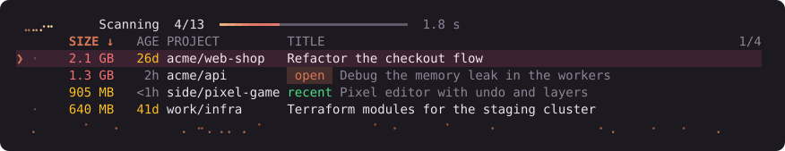
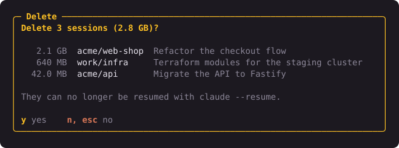
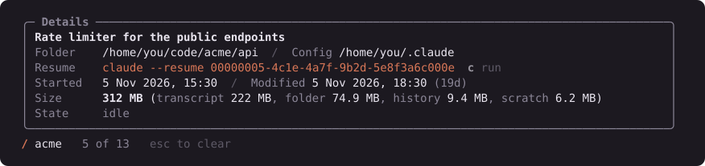

<h1 align="center">
    <picture>
        <source media="(prefers-color-scheme: dark)" srcset="assets/logo-dark.svg" />
        
    </picture>
</h1>

Interactive cleanup of [Claude Code](https://claude.com/claude-code) sessions. Claude Code keeps every conversation as a transcript in `~/.claude/projects`, and a few long sessions quickly weigh several gigabytes. `ccleanup` lists them by size, shows what each one was about, lets you mark the ones to delete, and can remind you to come back.

The list opens at once and grows while the sessions are measured. The header shows the totals, what is marked, what could be freed and what was freed, and deletions run in the background with a per-row state, so the list stays usable.

<picture>
    <source media="(prefers-color-scheme: light)" srcset="assets/hero-light.svg" />
    
</picture>

Sessions open in Claude Code are tagged `open` and recent ones `recent`, and neither can be marked.

**Scan.** The list fills in as the sessions are measured, a firefly on the scan line and embers under the rows.



**Confirmation.** Before anything goes, a box lists the marked sessions and the space they free.



**Search and details.** `/` narrows the list, `i` shows what a session is made of and how to resume it.



Drawn from the real interface, on made-up sessions.

## Usage

Run it without installing it, with the tool you already have:

| Tool | Command                |
| ---- | ---------------------- |
| npm  | `npx ccleanup`         |
| Bun  | `bunx ccleanup@latest` |
| pnpm | `pnpm dlx ccleanup`    |

These examples use `npx`; the other tools take the same options. None of them deletes anything without asking:

```bash
npx ccleanup                      # interactive list
npx ccleanup --older-than 14d     # same, with sessions older than 14 days pre-marked
npx ccleanup --list               # print the list and exit
npx ccleanup --older-than 30d --min-size 100M --dry-run    # preview a bulk cleanup
```

Without the UI, `--yes` deletes the targeted sessions at once, with no confirmation. Preview them with `--dry-run` first:

```bash
npx ccleanup --older-than 30d --yes
```

### From a clone

```bash
git clone git@github.com:20syldev/ccleanup.git
cd ccleanup
npm install       # also builds dist/
npm link          # puts `ccleanup` on the PATH (or run `node dist/cli.js`)
```

### Keys

| Key                      | Action                                                                                                                                        |
| ------------------------ | --------------------------------------------------------------------------------------------------------------------------------------------- |
| Up, Down / `j` `k`       | Move                                                                                                                                          |
| `PgUp` `PgDn` / `g` `G`  | Page up or down, top, bottom                                                                                                                  |
| `space`                  | Mark or unmark the session, then move the way you last moved (not in details)                                                                 |
| `a`                      | Mark or unmark everything                                                                                                                     |
| `o`                      | Mark sessions older than `--older-than` (14 days by default)                                                                                  |
| `s`, `S`                 | Cycle the sort: size, age, project; reverse the order                                                                                         |
| `/`                      | Search by project, title, folder or id; `enter` keeps it, `esc` clears it                                                                     |
| `i`                      | Show the details of the session under the cursor                                                                                              |
| `c`                      | In the details, quit and run `claude --resume` on the session                                                                                 |
| `?`                      | Help and legend                                                                                                                               |
| `enter`                  | Delete the marked sessions, after a confirmation box listing them                                                                             |
| `e`                      | Show the deletion errors                                                                                                                      |
| `q`, `esc`               | Quit, or stop after the current deletion; `esc` first closes a panel or clears the search                                                     |
| Click, wheel             | With `CCLEANUP_MOUSE=1`: click a row to select it, click the selected row to mark it, right-click to show its details; the wheel moves 3 rows |
| `Ctrl+C` twice, `Ctrl+Z` | Quit, suspend                                                                                                                                 |

### Options

| Option                 | Description                                                                                           |
| ---------------------- | ----------------------------------------------------------------------------------------------------- |
| `-l`, `--list`         | Print the list instead of opening the UI (also the default when not in a terminal)                    |
| `--older-than <d>`     | Only target sessions older than `<d>`: `12h`, `14d`, `2w`, `3m`                                       |
| `--min-size <s>`       | Only target sessions bigger than `<s>`: `100K`, `500M`, `1G`                                          |
| `-y`, `--yes`          | Delete the targeted sessions without the UI. Requires `--older-than` or `--min-size`                  |
| `-n`, `--dry-run`      | Show what would be deleted, delete nothing                                                            |
| `--include-recent`     | Allow deleting sessions modified less than 30 minutes ago                                             |
| `--claude-dir <dir>`   | Claude config folder, repeatable (default: every folder found, see below)                             |
| `--install-reminder`   | Install a systemd user timer that notifies when there is cleaning to do                               |
| `--every <p>`          | Reminder period: `daily`, `weekly` (default) or `monthly`                                             |
| `--notify-above <s>`   | Notification threshold (default `1G`)                                                                 |
| `--uninstall-reminder` | Remove that timer                                                                                     |
| `--check`              | What the reminder runs, by hand: summarize what could be cleaned (14 days by default), delete nothing |
| `--notify`             | With `--check`: send a desktop notification above the threshold                                       |

### Environment

| Variable                  | Effect                                                                                       |
| ------------------------- | -------------------------------------------------------------------------------------------- |
| `CCLEANUP_LANG=fr\|en`    | Interface language; by default French for a French locale, else English                      |
| `CCLEANUP_ASCII=1`        | Draw the interface with ASCII glyphs only                                                    |
| `CCLEANUP_NOTIFY=<cmd>`   | Notification command, called with the text then the title                                    |
| `NO_COLOR`, `FORCE_COLOR` | Disable or force colors                                                                      |
| `NO_UPDATE_NOTIFIER=1`    | Never look for a newer version (see below)                                                   |
| `CCLEANUP_MOUSE=1`        | Report clicks and the wheel to the interface; the terminal then selects text with Shift held |

The colors follow the terminal: true color, 256 or 16 colors, or none. The background is asked to the terminal (OSC 11, then `COLORFGBG`), and a light background gets a darker palette.

## Reminder

```bash
npm i -g ccleanup
ccleanup --install-reminder --every weekly --older-than 14d --notify-above 1G
```

This writes `ccleanup-reminder.service` and `.timer` in `~/.config/systemd/user` and enables the timer. Once a week, it checks the sessions and sends a desktop notification, only when more than 1 GB can be freed. `--dry-run` prints the units without writing anything, and `--uninstall-reminder` removes them. The notification uses `notify-send`; set `CCLEANUP_NOTIFY` to your own command to use something else.

## Update notice

When the interface closes, a line tells you if a newer version exists:

```
ccleanup  Nothing deleted, see you next time.
          1.1.0 is available, you have 1.0.3: npm i -g ccleanup@latest
```

This is the only network call `ccleanup` makes. While the interface is open, it asks the npm registry (`https://registry.npmjs.org/ccleanup/latest`) for the latest version, at most every 12 hours, and keeps the answer in `$XDG_CACHE_HOME/ccleanup/update.json` (`~/.cache` by default). The request carries nothing about you or your sessions, never delays the start or the exit, and is dropped when it is not over in time. Nothing is asked with `--list`, `--check`, `--yes` or `--dry-run`, under `npx` or in CI, nor when `NO_UPDATE_NOTIFIER` is set.

## What is deleted, and what is not

A session is a transcript `<uuid>.jsonl` in `~/.claude/projects/<project>/`, plus what Claude Code stores next to it: the `<uuid>/` folder (tool results, subagents, workflows), `file-history/<uuid>`, `session-env/<uuid>` and `debug/<uuid>.txt`. These are deleted together, and their sizes are counted together.

Without `--claude-dir`, every config folder found is listed together: `$CLAUDE_CONFIG_DIR`, `~/.claude` and `~/.config/claude` (or `$XDG_CONFIG_HOME/claude`), each one counted once even through a symbolic link. A folder that exists but cannot be read is reported with its path, instead of an empty list.

Only entries named after a session UUID are ever listed or deleted. Everything else is left alone: the `memory/` folder of a project, `history.jsonl`, settings, skills, plugins. Every path is checked to be inside the config folder and named after the session before anything is removed. Sessions open in a running Claude Code are tagged `open` and never deleted, even with `--include-recent`: ccleanup reads the record Claude Code keeps for each running instance (`sessions/<pid>.json`) and checks that its process still runs, and on Linux it also looks for session ids passed to running commands (`--resume <id>`). It checks again right before deleting. Sessions modified less than 30 minutes ago are tagged `recent`, since one of them may be running without a record, and are protected unless you pass `--include-recent`.

A deleted session can no longer be resumed with `claude --resume`.

## Keeping sessions longer

Claude Code deletes on its own, without a message, the sessions older than 30 days. To keep them, raise `cleanupPeriodDays` in `~/.claude/settings.json` (`0` is refused, so use a large number):

```json
{ "cleanupPeriodDays": 3650 }
```

Sessions then pile up until you remove them, and that is where `ccleanup` is useful: instead of Claude Code dropping everything after 30 days, you pick what goes, biggest and oldest first. `ccleanup` never edits this file.

## Scripts

| Script                | Description                                                            |
| --------------------- | ---------------------------------------------------------------------- |
| `npm run build`       | Clean `dist/`, then compile `src/` into it (also run by `npm install`) |
| `npm run dev`         | Compile in watch mode                                                  |
| `npm run clean`       | Remove `dist/`                                                         |
| `npm test`            | Run the tests with `node --test` (Node 22.18+ for TS)                  |
| `npm run check`       | `tsc --noEmit` + ESLint + Prettier (check) + screenshots up to date    |
| `npm run format`      | Prettier + ESLint (write)                                              |
| `npm run screenshots` | Draw the screenshots of `assets/` from the real view (Node 22.18+)     |
